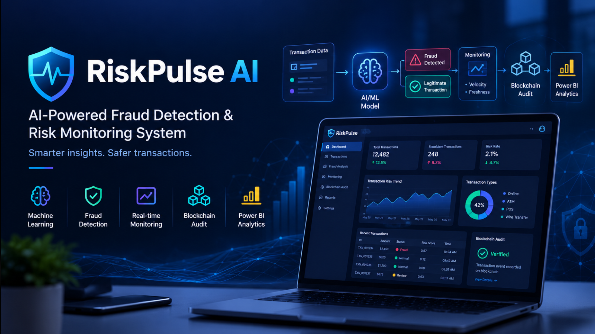
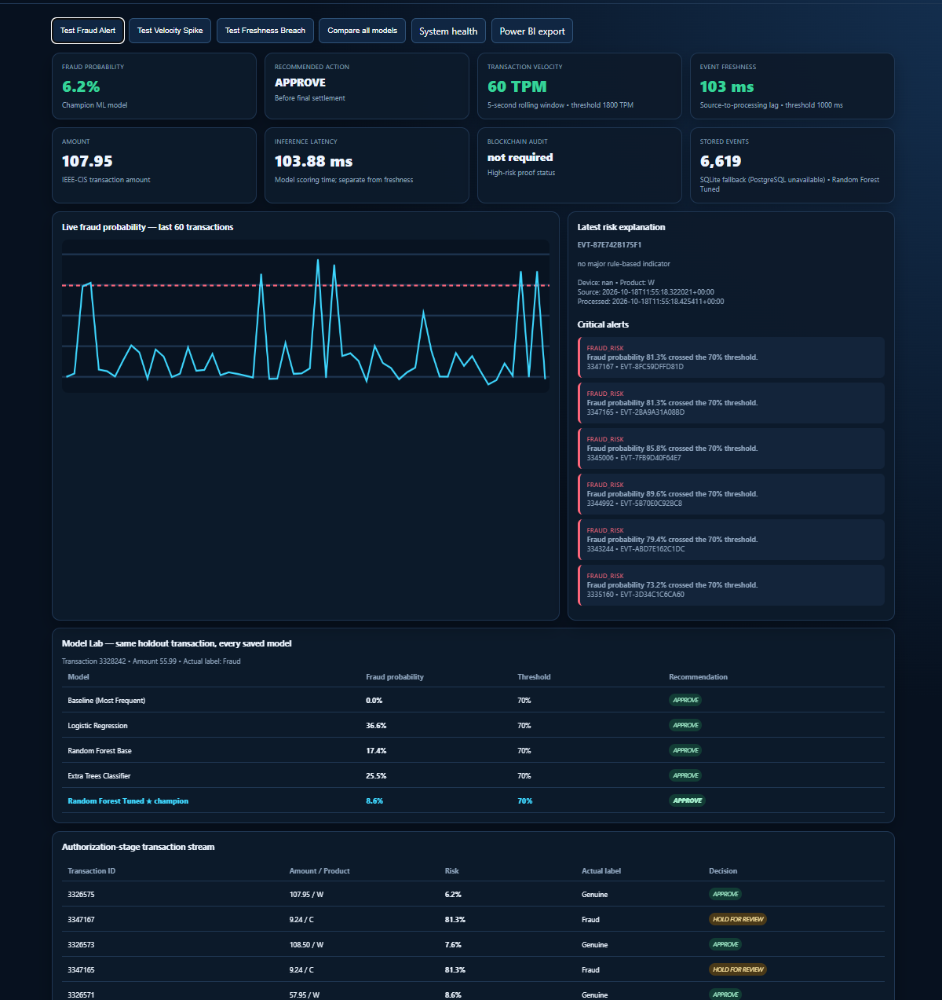
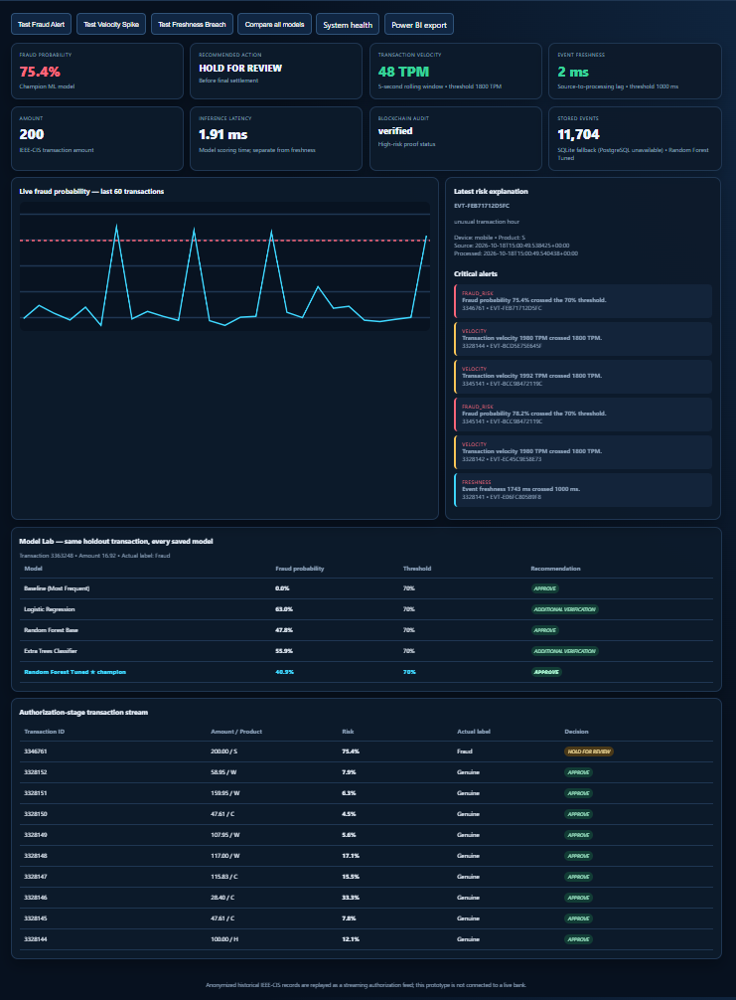
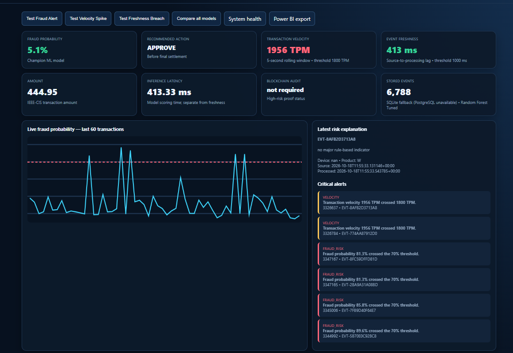
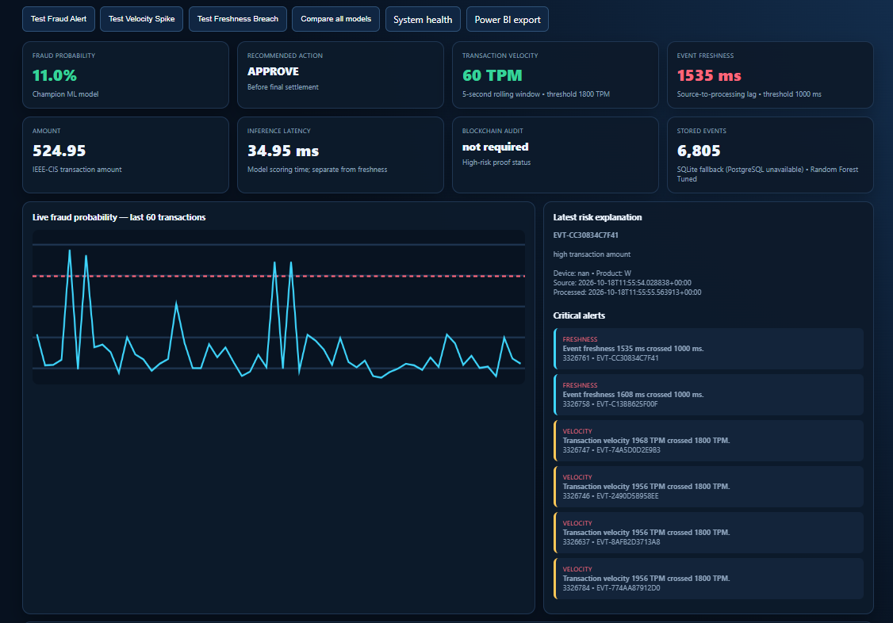
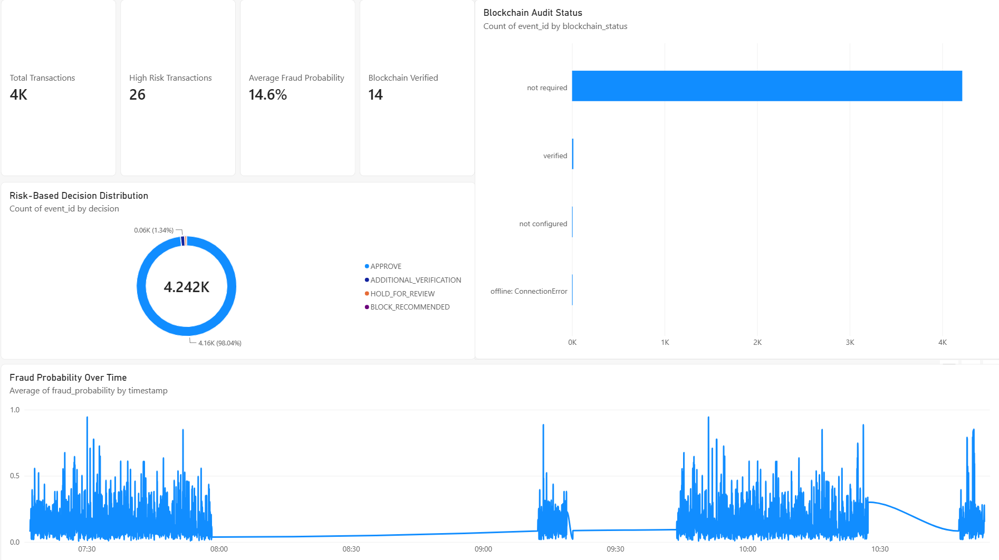
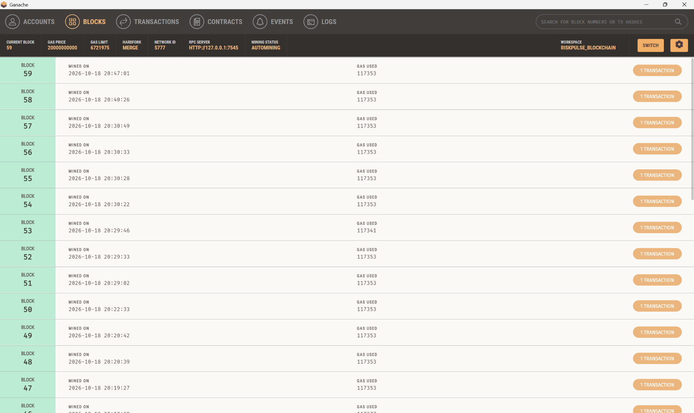

# 🛡️ RiskPulse-AI
### AI-Powered Fraud Detection & Real-Time Risk Monitoring System



RiskPulse-AI is an intelligent fraud detection and risk monitoring platform that combines **Machine Learning, real-time transaction monitoring, blockchain-based audit logging, and interactive analytics**.

The system is designed to identify suspicious financial transactions, assess fraud risk, monitor unusual activity, and provide insights through an interactive dashboard.

---

## 🚀 Key Features

- **AI-Powered Fraud Detection:** Uses machine learning models to identify potentially fraudulent transactions.
- **Real-Time Risk Monitoring:** Tracks transaction activity, unusual patterns, and operational risk indicators.
- **Risk Scoring:** Supports fraud risk assessment and classification.
- **Transaction Velocity Monitoring:** Highlights sudden spikes in transaction activity.
- **Event Freshness Monitoring:** Identifies delays in incoming transaction events.
- **Blockchain Audit Logging:** Uses Solidity and Web3 for blockchain-based audit functionality.
- **Interactive Dashboard:** Visualizes transaction monitoring and fraud-related information.
- **Power BI Analytics:** Provides additional business intelligence and analytical visualizations.
- **Model Evaluation:** Supports comparing machine learning algorithms and their performance.

---

## 🖥️ Application Dashboard

The RiskPulse-AI dashboard provides a centralized interface for monitoring transaction activity, fraud indicators, and risk-related insights.



---

## 🚨 Fraud Detection & Risk Assessment

The fraud detection module analyzes transaction information and highlights suspicious activity to support investigation and risk assessment.



---

## 📈 Transaction Velocity Monitoring

Transaction velocity monitoring helps identify unusual increases in transaction frequency that may indicate suspicious activity.



---

## ⏱️ Event Freshness Monitoring

Event freshness monitoring helps identify delays in transaction processing and supports operational visibility.



---

## 📊 Power BI Analytics

Power BI provides additional visual analytics for examining transaction trends, fraud patterns, and risk-related insights.



---

## ⛓️ Blockchain-Based Audit Logging

RiskPulse-AI incorporates blockchain technology for audit-related functionality using Solidity smart contracts, Web3, and a local Ethereum development environment.



---

## 🧠 Machine Learning Models

The project incorporates multiple machine learning algorithms for fraud detection and model evaluation.

| Algorithm | Purpose |
|---|---|
| Random Forest | Ensemble-based fraud classification |
| Extra Trees | Tree-based ensemble classification |
| Logistic Regression | Baseline classification and comparison |

The trained model is stored as a Joblib artifact for use in the application's prediction workflow.

---

## 🛠️ Technology Stack

| Component | Technologies |
|---|---|
| Programming Language | Python |
| Backend | FastAPI |
| Machine Learning | Scikit-learn, Pandas, NumPy |
| ML Model Storage | Joblib |
| Frontend | HTML, CSS, JavaScript |
| Database | PostgreSQL, SQLite |
| Blockchain | Solidity, Web3 |
| Blockchain Development | Ganache |
| Data Visualization | Power BI |
| Containerization | Docker, Docker Compose |
| Version Control | Git, GitHub |

---

## 🏗️ System Architecture

The platform is organized around transaction analysis, machine learning inference, risk monitoring, data storage, and audit logging.

```text
                Transaction Data
                       |
                       v
               FastAPI Backend
                       |
           +-----------+-----------+
           |                       |
           v                       v
    ML Fraud Detection      Risk Monitoring
           |                       |
           +-----------+-----------+
                       |
                       v
              Database / Records
                       |
           +-----------+-----------+
           |                       |
           v                       v
    Web Dashboard          Blockchain Audit
           |
           v
      Power BI Analytics
```

This diagram provides a high-level conceptual overview of the project components.

---

## ⚙️ Installation & Setup

### 1. Clone the Repository

```bash
git clone https://github.com/RC0809/RiskPulse-AI.git
cd RiskPulse-AI
```

### 2. Create a Virtual Environment

```bash
python -m venv venv
```

Activate it on Windows:

```bash
venv\Scripts\activate
```

### 3. Install Dependencies

```bash
pip install -r requirements.txt
```

### 4. Prepare the Required Data and Model

Ensure the trained model artifacts and required processed datasets are available at the paths expected by the application.

### 5. Start the Application

```bash
uvicorn app:app --reload
```

Open the local application URL displayed in the terminal.

**Note:** Full functionality may require PostgreSQL, blockchain development services, environment configuration, and the required processed datasets. Review the project configuration before running.

---

## 📸 Project Screenshots

| Module | Preview |
|---|---|
| Main Dashboard |  |
| Fraud Detection |  |
| Velocity Monitoring |  |
| Freshness Monitoring |  |
| Power BI Analytics |  |
| Blockchain Audit |  |

---

## 🚀 Future Enhancements & Roadmap

RiskPulse-AI is designed with the potential to evolve into a scalable, intelligent, and production-ready financial fraud detection platform. Future development will focus on improving detection accuracy, real-time processing, system security, and overall user experience.

### 🧠 1. Advanced AI & Machine Learning
- Integrate deep learning architectures such as LSTM and Transformer-based models to identify complex transaction patterns.
- Implement anomaly detection using Isolation Forest and Autoencoders to identify previously unseen fraud patterns.
- Introduce automated model retraining to adapt to evolving fraudulent activities.
- Incorporate Explainable AI (XAI) techniques such as SHAP and LIME to provide transparent explanations for fraud predictions.

### ⚡ 2. Real-Time Fraud Detection & Streaming
- Integrate Apache Kafka for scalable, high-throughput transaction streaming.
- Implement real-time fraud scoring with low-latency prediction pipelines.
- Introduce adaptive risk thresholds based on transaction behavior and historical patterns.
- Develop automated alert prioritization based on fraud probability and transaction severity.

### 🔗 3. Enhanced Blockchain Integration
- Expand blockchain-based audit logging to provide tamper-evident records of fraud detection decisions.
- Explore deployment of smart contracts on Ethereum-compatible blockchain networks.
- Implement cryptographic verification for transaction audit records.
- Develop an interface for verifying historical fraud detection decisions through blockchain records.

### 📊 4. Advanced Analytics & Visualization
- Develop customizable dashboards with interactive charts and advanced filtering.
- Introduce fraud trend forecasting and predictive risk analytics.
- Expand Power BI reporting with additional KPIs and historical comparisons.
- Implement automated generation of fraud investigation reports.

### ☁️ 5. Cloud Deployment & Scalability
- Deploy the application using AWS, Microsoft Azure, or Google Cloud.
- Introduce container orchestration using Kubernetes for scalable deployment.
- Implement automated CI/CD pipelines using GitHub Actions.
- Integrate centralized monitoring, application logging, and performance tracking.

### 🔐 6. Security & Access Management
- Implement role-based access control (RBAC) for administrators, analysts, and auditors.
- Introduce secure authentication using OAuth 2.0 and JWT.
- Enhance data protection through encryption and secure API communication.
- Add audit trails for user activities and administrative actions.

### 🤖 7. Intelligent Fraud Investigation
- Develop an AI-assisted investigation module to summarize suspicious transactions.
- Introduce behavioral profiling to detect unusual customer activity.
- Implement graph-based fraud detection to identify suspicious relationships between accounts.
- Enable analyst feedback to support continuous improvement of fraud detection models.

### 🌐 8. Production-Ready Platform
- Develop a responsive interface optimized for desktop and mobile devices.
- Introduce configurable email and notification alerts.
- Add support for integration with external financial APIs and payment gateways.
- Implement automated testing, performance benchmarking, and reliability monitoring.

---

### 🎯 Long-Term Vision

The long-term vision of **RiskPulse-AI** is to develop a comprehensive, AI-driven financial risk intelligence platform that combines machine learning, real-time analytics, blockchain-based auditability, and intelligent automation.

By continuously improving detection capabilities, scalability, explainability, and security, RiskPulse-AI aims to support faster fraud identification, more transparent decision-making, and efficient financial risk management.

---

## 🎯 Project Objective

The objective of RiskPulse-AI is to explore how artificial intelligence, real-time monitoring, data analytics, and blockchain technology can work together to support fraud detection and financial risk analysis.

---

## 📄 License

No license has been added to this repository.

---

⭐ If you find this project interesting, consider starring the repository!
